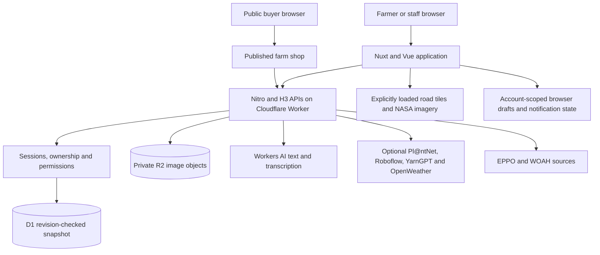

# FarmBuddy Product Requirements Document

**Product:** FarmBuddy, Smart AI Farming Management System  
**Document version:** 1.0  
**Date:** October 24, 2026  

## 1. Purpose

FarmBuddy is a responsive, full-stack web application that brings crop and livestock planning, daily operations, inventory, sales, bookkeeping, a shareable farm shop, farmer connections and AI-assisted guidance into one workspace.

This PRD documents the current product and its requirements. It is not a claim that every integration is enabled in production, that every scenario has passed live acceptance, or that proposed work is already shipped.

Where older roadmap descriptions conflict with source code, this document follows the current code. In particular, native Cloudflare Workers AI supplies chat and server-side transcription. Supabase is not the active production authentication or database stack.

## 2. Product vision

Help farmers manage everyday work, understand their records, get useful guidance and present their products to buyers without moving between disconnected notebooks, message threads and tools.

### Product goals

1. Keep production plans, tasks, stock movements and business records connected.
2. Make farm records practical on phones and in limited-connectivity situations.
3. Give farmers their own product storefront and a link they can post or share.
4. Support farming questions through text, reviewed voice input and specialist photo tools.
5. Provide weather, area context and sourced health information with clear limitations.
6. Enable consent-based collaboration and farmer discovery without exposing private data by default.
7. Preserve farmer control over publication, permissions, AI context and consequential actions.

### Non-goals

FarmBuddy is not a payment processor, escrow service, shipping provider, full accounting package, verified professional directory, autonomous farm operator or diagnostic medical/veterinary system. It does not promise yield improvement, clinically validated scan accuracy, live satellite surveillance, full offline operation or automatic translation.

## 3. Farmer problems and feature alignment

These are the problems the product is designed to address, not independently measured findings from a customer survey.

| Farmer problem | Product response |
|---|---|
| Crop dates, animal care, plots and observations are scattered | Crop/herd registers, mapped plots, seasons, schedules and dated production events |
| Farmers cannot easily see who owns a job or what supplies were used | Assigned tasks, due dates, completion tracking, stock consumption and role-based teamwork |
| Harvest, stock, sales and expense records do not reconcile easily | Atomic harvest-to-stock and confirmed-sale-to-stock/cashbook flows, bookkeeping and seasonal summaries |
| Farmers repeatedly send product photos and prices to individual buyers | Their own customizable shop, published listings and a shareable shop link |
| Buyers do not have a simple way to organize enquiries | Public catalog, enquiry basket, estimated totals and copyable enquiry summary |
| Farmers need help identifying plants, interpreting concerning photos and asking farm-specific questions | Plant identification, possible disease/pest suggestions, AI chat and opt-in farm-record context |
| Typing can slow fieldwork | Microphone recording, transcription, editable transcript and optional spoken answers |
| Farmers must switch tools to check weather and area conditions | Farm Watch, five-day forecasts, planning prompts, road/satellite maps and sourced bulletins |
| Farmers want to find peers without publishing exact locations or contact details | Opt-in approximate discovery, connection requests, acceptance and blocking |
| Weak connectivity interrupts record capture | Account-scoped offline notes and supported workspace drafts with explicit reconciliation |
| Shared access can expose private information | Owner, manager, worker and viewer permissions enforced by the server |

## 4. Users and permissions

### Primary users

- **Crop farmer:** Plans seasons and field activities, records harvests, monitors inputs and sells produce.
- **Livestock/poultry farmer:** Tracks groups or registers, feeding, breeding, health observations and production.
- **Mixed farmer:** Uses both production types from a combined dashboard.
- **Farm owner:** Controls the farm workspace, team access, catalog and private records.
- **Manager:** Coordinates permitted planning, tasks and business workflows.
- **Worker:** Completes assigned work and records permitted events and stock usage.
- **Viewer:** Reads permitted planning and task information without modifying it.
- **Buyer:** Browses a published farm shop and contacts the farmer outside the application.
- **Connected farmer:** Discovers opted-in peers and requests contact sharing.

### Connected-workspace access matrix

| Capability | Owner | Manager | Worker | Viewer |
|---|---|---|---|---|
| Read permitted plans/tasks | Yes | Yes | Yes | Yes |
| Create plots/seasons/schedules | Yes | Yes | No | No |
| Record permitted production events | Yes | Yes | Yes | No |
| Create/assign tasks | Yes | Yes | No | No |
| Complete tasks/use task stock | Yes | Yes | Assigned work only | No |
| Read/write connected business information | Yes | Yes | No | No |
| Invite or revoke members | Yes | No | No | No |
| Change owner's profile, shop or legacy private records through shared-farm access | Owner only | No | No | No |

Permissions apply to the connected workspace. Legacy tools remain account-owner scoped. A private contact roster entry does not grant application access. AI operational-record retrieval currently covers the signed-in owner's own farm, not another owner's shared farm.

## 5. Functional requirements

### FR-01. Public site, accounts and onboarding

**Status:** Implemented.

- Provide a public product introduction and registration/login entry points.
- Support application-owned email/password registration, login, session lookup and logout.
- Collect farm name, type, principal crops/animals, optional location and preferred language during onboarding.
- Route crop farmers to `/dashboard/crops`, animal/poultry farmers to `/dashboard/livestock`, and mixed farmers to `/dashboard`.
- Return existing onboarded users to their workspace. Ask incomplete accounts to finish onboarding.
- Provide authenticated farm-profile/settings editing. Name/email are read-only in the existing settings experience.
- Treat language as a preference, not evidence of a translated interface.
- Do not describe email verification, password recovery or social login as shipped requirements without separate implementation evidence.

**Acceptance:** A new user reaches the appropriate dashboard after onboarding. A user cannot read another user's private data by altering request IDs. Signing out invalidates the current session.

### FR-02. Tailored home dashboard and service visibility

**Status:** Implemented.

- Show farm-specific navigation, real records and useful empty states.
- Expose production, operations, business and supporting tools without fabricated activity or farmers.
- Show configuration/availability states for optional services rather than pretending unavailable tools work.
- Maintain profile/settings access and account-aware navigation.

**Acceptance:** Empty farms start empty. Unconfigured integrations display an honest unavailable state and do not return invented results.

### FR-03. Crop and herd registers

**Status:** Implemented.

- Create and edit crop/herd entries with names, quantity, unit, start date and notes.
- Support confirmed deletion and owner-scoped access.
- Allow production seasons to reference a compatible existing enterprise/register entry.
- Accommodate crop, livestock and poultry records without implying individual-animal clinical records in every case.

### FR-04. Plots, seasons and production planning

**Status:** Implemented.

- Create named plots with map boundaries and optional area in hectares.
- Create crop seasons or livestock management periods with dates and optional plot/register links.
- Add dated schedules and events for planting, feeding, breeding, health, production and observations.
- Associate harvests with seasons through the connected business workflow.
- Keep events as farmer-entered records, not automatically verified farm conditions.

**Acceptance:** Invalid dates, foreign plot/register IDs and unauthorized planning changes are rejected. Failed requests preserve drafts and do not partially persist changes.

### FR-05. Team collaboration and daily operations

**Status:** Implemented.

- Invite existing or prospective account holders by email identity using an explicitly shared invitation token.
- Require the signed-in invitee's email to match and require explicit acceptance.
- Support manager, worker and viewer roles. Invitations cannot grant ownership.
- Expire invitations after seven days and revoke access when a member is removed.
- Create tasks with title, due date, optional season and optional assignee.
- Show actual open/completed task states, filtering and operational boards.
- Let assigned workers complete work and record permitted inventory consumption.
- Preserve the separately labelled legacy contact roster.
- Do not claim automatic invitation email delivery, payroll, location tracking or unrestricted owner settings access.

**Acceptance:** Removal immediately prevents subsequent authorized API access. An unassigned worker cannot consume task stock. Repeated identical commands do not duplicate effects.

### FR-06. Inventory and stock movements

**Status:** Implemented.

- Track physical quantities, units, editable stock details, low-stock thresholds and expiry indicators.
- Require confirmation for destructive actions.
- Associate task consumption, harvest additions and sale deductions with stock movements.
- Keep manual inventory adjustments distinct from money records.
- Reject insufficient stock and invalid quantities.

### FR-07. Connected harvest, sales, invoices and delivery

**Status:** Implemented.

- Record harvest quantity, date, season and explicitly selected inventory item.
- Atomically create the harvest event, stock movement and stock increase.
- Create sales/order drafts containing season, stock item, quantity, unit price, customer and date.
- A draft must not reduce stock or create income.
- Explicitly confirm a paid cash sale to atomically deduct stock and add exactly one income record and movement.
- Use bounded monetary validation and integer minor-unit arithmetic for order calculations.
- Provide printable invoices/receipts from confirmed orders without legal tax-compliance claims.
- Track pending, dispatched and delivered statuses with optional references for confirmed orders.
- Cancel draft orders only. Reversal of confirmed sales is not implemented.
- When linking a catalog product, require ownership and explicit inventory mapping. Do not silently synchronize unrelated public listing quantities.

**Acceptance:** Confirming the same sale again cannot double-charge stock or duplicate income. Insufficient stock produces no partial mutation. The user must understand that recording a paid sale does not collect payment.

### FR-08. Records, bookkeeping and seasonal reporting

**Status:** Implemented.

- Record income, expenses and non-financial activities.
- Provide journal search, category/date filters, editing/deletion where allowed and calendar/list reminder views.
- Add, edit, complete and delete in-app reminders.
- Provide monthly/all-time financial totals, search/type filters and filtered CSV export.
- Exclude activity-only entries from financial totals.
- Link seasonal expenses and confirmed-sale income to seasonal business summaries, keeping unallocated amounts separate.
- Protect workflow-generated financial entries from edits that would break connected records.
- Describe cash balance as recorded income minus recorded expenses. Seasonal summaries are based on recorded entries, not comprehensive accounting profit or valuation.

### FR-09. Farm shop and seller catalog

**Status:** Implemented.

- Give each seller a unique lowercase farm slug and public route `/<farm-slug>/products`.
- Let farmers post their own shop link on social media or send it directly to buyers.
- Use the actual deployment origin when constructing links. Do not imply automatic custom-domain registration.
- Create products with descriptions, unit prices, quantities, currency and optional photos.
- Provide seller search, publication filters and dedicated product editing.
- Offer shop design controls: welcome headline/tagline, cover image, optional banner, green/teal/sage themes and preview.
- Require explicit saving and separate storefront/product publication decisions.
- Require explicit consent before exposing ordering contact details.
- Explain that changing the slug changes the shared URL.

**Acceptance:** Draft listings never appear in public responses. Unpublishing removes public catalog/media access according to current publication rules.

### FR-10. Public buyer enquiries

**Status:** Implemented.

- Browse published products without access to private farm records.
- Build an in-memory enquiry basket with positive quantities bounded by displayed stock.
- Show currency-separated estimated totals and a copyable enquiry summary.
- Let buyers contact the farmer to confirm availability, payment and delivery independently.
- Clear the basket on reload. Do not send messages automatically or reserve stock.
- Make external image loading a buyer-controlled choice because it contacts another host.

**Boundary:** No online checkout, card collection, escrow, automated shipping or automatic conversion of an enquiry basket into a confirmed business sale.

### FR-11. Product and shop-cover images

**Status:** Implemented.

- Accept camera/gallery/computer JPEG, PNG and WebP inputs. HEIC requires conversion.
- Validate signatures, dimensions and decoded pixels, apply orientation, resize and re-encode to JPEG.
- Strip EXIF/GPS metadata and flatten transparency to white.
- Use private account-owned objects with backend-controlled access.
- Allow public retrieval only when the corresponding product/storefront publication rules permit it.
- Preserve object privacy when R2 is unavailable. Do not fall back to public raw uploads.

**Current limits:** 8 MiB upload, 4 MiB stored JPEG, 1600 × 1600 output bounding box, 4-megapixel Worker input cap, 40-megapixel local Node input cap, 500 photos per account and ten upload attempts per minute. These are implementation limits, not performance guarantees. Detaching a photo does not delete its object. Unused-object cleanup remains operational work.

### FR-12. FarmBuddyAI text assistance and farm context

**Status:** Provider-dependent through native Workers AI.

- Answer farming questions using `@cf/openai/gpt-oss-120b`, selected in Worker configuration.
- Keep chat separate from plant and animal image inference. The configured chat model is text-only.
- Offer an initially unchecked control to include selected operational farm records for a conversation.
- Construct bounded owner-scoped context on the server when the farmer sends a request.
- Exclude financial entries, private notes, team/contact data, invitations, orders/buyer information and credentials from operational retrieval.
- Retrieve relevant short passages from a small curated agricultural reference collection, with source references visible alongside answers.
- Treat farm-entered text and retrieved snippets as untrusted context, not instructions.
- Reset conversation/consent appropriately on account or consent changes.
- Provide no AI write tools: chat cannot change farm records, send messages or make payments.
- Present advice with uncertainty and professional escalation. Do not promise diagnostic accuracy, guaranteed source grounding, zero provider retention or automatic model training.

**Technical boundary:** Retrieval-assisted prompting uses curated references and bounded snapshots. There is no required vector database, embeddings pipeline or fine-tuning system.

### FR-13. Voice input, reviewed record capture and spoken replies

**Status:** Implemented interfaces with provider/browser dependencies.

- Record microphone audio after explicit action, show active recording state and stop controls, then transcribe through Workers AI.
- Use `@cf/openai/whisper-large-v3-turbo` with fixed transcription mode, not automatic translation.
- Return an editable transcript. Require review and an explicit Send or save action.
- Support reviewed voice-to-record fields for category, title, amount and notes. Do not infer money from speech without farmer confirmation.
- Keep typed/pasted input available where microphone access or transcription fails.
- Maintain browser speech/dictation compatibility paths where supported. Browser speech support is separate from server transcription.
- Optionally read answers aloud through YarnGPT only after the user selects the action.
- Do not promise universal language recognition or voice coverage. The server currently accepts transcription language hints `en`, `ha`, `yo`, `fr` and `sw`, which is not evidence of evaluated accuracy.

**Current transcription limits:** 2 MiB audio, 3 MiB request-body cap, validated WebM/Ogg/MP4/WAV data, bounded response text and a 45-second application wait limit. That wait limit does not guarantee upstream inference cancellation. Audio is not saved by FarmBuddy's transcription implementation. HTTPS or localhost is required for normal microphone access.

### FR-14. Plant identification and possible crop disease/pest checks

**Status:** Provider-dependent through Pl@ntNet.

- Offer explicit photo selection/capture, preview and scan actions.
- Support up to five same-plant photos and plant-part selection within bounded upload limits.
- Return species/taxonomy suggestions and credited comparison images where provided.
- Offer the limited disease/pest-screening capability separately from plant identification.
- Make clear that identification is not an edibility assessment and possible disease matches are not diagnoses.
- Allow supported results to prepare a question for reviewed AI follow-up without automatically sending it.
- Keep provider credentials private and preserve reference-image attribution/licence information.

**Acceptance:** Invalid/oversized inputs fail before provider submission. An unavailable provider produces an error, not a fabricated match. Provider failures and redirects must be handled safely in the actual Worker runtime.

### FR-15. Experimental cattle photo-pattern screening

**Status:** Experimental and disabled by default.

- Require both `ROBOFLOW_API_KEY` and the explicit experimental enable flag.
- Use the fixed research detector `cattle-disease-detection/1` rather than presenting a universal animal classifier.
- Prepare and validate images, strip metadata and contact the fixed provider only after explicit scan action.
- Highlight supported model-returned regions without claiming pathogen identification or diagnostic probability.
- Ignore healthy/object predictions as evidence of health. No returned region does not mean an animal is healthy.
- Do not save scan photos/results or silently send them to chat.

**Evidence limit:** The supporting research dataset is small and is not independent clinical validation. Veterinary-defined tasks, representative datasets and prospective evaluation are required before any diagnostic use. Poultry diagnosis and universal livestock recognition are not implemented.

### FR-16. Farm Watch, forecasts and planning prompts

**Status:** Implemented UI, provider-dependent live weather.

- Accept manual coordinates or request device location only after explicit permission.
- Round coordinates to 0.1° before weather requests and keep the selected area in dashboard memory.
- Request the OpenWeather five-day/three-hour forecast, not the paid One Call API.
- Aggregate available periods honestly, label partial days and show source/attribution.
- Cache normalized forecasts server-side for 15 minutes by rounded area.
- Add simple farm-profile-aware heat, rain and cold planning prompts.
- Show missing data and provider errors rather than inventing forecasts.
- Continue checks across dashboard tools only after an area is selected, at most every 15 minutes while visible.

**Boundary:** Thresholds are illustrative planning prompts, not crop-specific safety limits or official warnings. Reloading/closing clears the monitoring area and stops checks.

### FR-17. Health bulletins and notifications

**Status:** Implemented sourced information with availability limits.

- Use optional country selection for EPPO country reporting, not location-inferred country claims.
- Label EPPO reports by publication month and country scope within a conservative recent window.
- Label WOAH animal-health feed information as global, not a nearby verified outbreak.
- Provide official source links and distinguish unavailable sources from no recent matching headlines.
- Support unread/read/dismissed notification state in account-scoped browser storage.
- Offer separate opt-in browser notifications for the visit, with deduplication and no alerts for stale/month-only health reports.

**Boundary:** No verified hyperlocal outbreak integration, background push, SMS or disease-free certification. A failed or empty source does not establish absence of disease.

### FR-18. Maps and satellite context

**Status:** Implemented with external map/imagery dependencies.

- Use Leaflet and attributed road tiles, with explicit load/unload actions.
- Show approximate forecast-area context and dated NASA GIBS satellite imagery.
- Allow mapping of user-entered plots in production planning.
- Explain that broad-area satellite imagery can be delayed or cloudy and has limited detail, approximately 250 m for the documented area imagery.
- Keep forecast selection distinct from map panning.
- Preserve useful non-map interfaces if tiles fail.

**Boundary:** No NDVI pipeline, live field cameras, field-level disease detection, sensor network or satellite-derived yield prediction. Public tile services require appropriate use and attribution, not bulk prefetching.

### FR-19. Farmer discovery and private connections

**Status:** Implemented.

- Keep discoverability off by default.
- Require explicit consent, public farm name and rounded coordinates before publishing a profile.
- Display real opted-in farmers and group overlapping approximate markers.
- Allow list/map discovery, connection requests, explicit acceptance and blocking.
- Reveal contact details only according to accepted-connection and profile-visibility rules.
- Hide shared location/introduction/contact when a profile is hidden. Blocking must prevent mutual access.
- Do not fabricate farmers, exact boundaries, farmer verification or an in-app chat service.

### FR-20. Notes and limited offline field capture

**Status:** Implemented with deliberate limits.

- Save notes in account-scoped browser storage and retry note upload with idempotent IDs after reconnecting.
- Keep saved notes immutable in this flow. Revise by copying into a new draft.
- Support workspace drafts for event creation, assigned task completion, task stock consumption and harvest creation.
- On reconnect, require review and explicit send for workspace drafts, then recheck account, farm, permissions, stock and conflicts server-side.
- Prevent duplicate effects on replay and show pending/error states.
- Preserve the open page's in-memory copy if browser storage fails and warn the user.

**Boundary:** Browser storage is unencrypted, may remain after logout and is not cross-device backup. Full offline site reopening, automatic background sync, offline photo/chat support and service-worker installation are not guaranteed.

## 6. Critical end-to-end journeys

1. **First use:** Register → complete farm profile → tailored dashboard → add crop/herd and stock → create first season/task.
2. **Harvest to cashbook:** Create season and stock item → record harvest → verify stock increase → draft sale → confirm paid cash sale → verify one deduction and one income entry → print invoice and update delivery.
3. **Farmer shop to buyer enquiry:** Create shop and products → save design → consent to public contact → publish shop/listings → post link → buyer browses and copies basket → buyer contacts farmer. Internal sale recording is separate.
4. **Farm question:** Open AI → optionally consent to own operational records → type or record speech → review transcript → send → review answer/sources → optionally read aloud.
5. **Plant concern:** Select plant photos → review provider disclosure → scan → compare possible matches → optionally prepare an AI question → seek professional guidance when needed.
6. **Teamwork:** Owner shares invitation → matching account accepts → manager assigns task → worker records permitted completion/stock use → owner reviews movement.
7. **Field draft:** Save supported update without connectivity → reconnect → review pending draft → explicitly send → reconcile rejection/conflict without duplication.
8. **Weather and community:** Select approximate area → check forecast/bulletins → optionally load map → independently opt into farmer discovery → request and accept a connection.

## 7. Technology stack and implementation architecture

Versions below are installed versions from `package-lock.json`, not claims about the newest available releases. Dependency ranges in `package.json` can differ, for example Nuxt is declared as `^4.0.3` but resolves to 4.5.2.

| Layer | Technology used | Role |
|---|---|---|
| Application framework | Nuxt 4.5.2 | Full-stack application, file-based pages, server routes and build pipeline |
| UI framework | Vue 3.5.43 | Composition API, reactive state and single-file components |
| Application languages | JavaScript ES modules, Vue SFCs, HTML, CSS, SQL | Product/server logic, templates, styles and D1 initialization |
| Server framework | Nitro 2.13.4 and H3 1.15.11 | Nuxt server runtime, API handlers and HTTP utilities |
| Styling | Tailwind CSS 3.4.19, `@nuxtjs/tailwindcss` ^6.14.0, custom CSS | Responsive utility styling and FarmBuddy design system |
| Accessible UI primitives | Reka UI 2.11.0 | Dialog focus management, portals and keyboard-accessible tabs |
| Product UI components | FarmBuddy-owned `FbButton`, `FbPanel`, `FbField`, `FbDialog`, `FbTabs`, `FbBoard`, badges, headers and empty states | Consistent app-specific controls over native/Reka primitives |
| Icons | `lucide-vue-next` 1.0.0 | Vue icon components |
| Typography | Plus Jakarta Sans via Google Fonts, system fallbacks | Brand typography |
| Interactive maps | Leaflet 1.9.4 | Plot/area/farmer map rendering |
| Road tiles | OpenStreetMap default, configurable HTTPS tile template | Road map imagery with attribution |
| Satellite imagery | NASA GIBS | Dated broad-area context |
| Production hosting | Cloudflare Workers with `nodejs_compat` | Nitro Worker execution and application-owned request guard |
| Static assets | Workers `ASSETS` binding from `.output/public` | Built client/static asset serving |
| Production database | Cloudflare D1, SQLite SQL interface | Revision-checked application snapshot persistence |
| Image storage | Private Cloudflare R2 | Product and cover JPEG objects accessed through application authorization |
| Text AI | Cloudflare Workers AI `AI` binding, `@cf/openai/gpt-oss-120b` | FarmBuddyAI text answers |
| Speech-to-text | Workers AI `@cf/openai/whisper-large-v3-turbo` | Reviewed audio transcription |
| Speech output | YarnGPT API, optional | Explicit answer read-aloud |
| Plant vision | Pl@ntNet API, optional | Plant identification and limited disease/pest suggestions |
| Experimental animal vision | Roboflow serverless inference, optional and gated | Restricted cattle photo-pattern region screening |
| Forecasts | OpenWeather five-day/three-hour forecast API, optional | Forecast data and local planning context |
| Health information | EPPO and WOAH source adapters | Scoped plant/animal health bulletins |
| Production image processing | `@cf-wasm/photon` 0.4.0, WebAssembly | Actual decode/orientation/resize/re-encoding in Workers and local adapters |
| Image test tooling | Sharp 0.35.5, development dependency | Fixtures and image verification, not production codec |
| Authentication | Node-compatible crypto, scrypt, opaque server-side sessions | App-owned password/session security |
| Local development | Node.js, npm, Nuxt development server | Local web application and tooling |
| Local data fallback | Atomic JSON file and local image directory | Single-process development, not cloud production persistence |
| Cloud development/deployment | Wrangler 4.152.0, workerd, local D1/R2 emulation | Preview, deployment, bindings and secret management |
| Automated tests | Node test runner, Node assertions, Vue SFC/compiler/SSR checks and integration scripts | Domain, API, UI-contract and runtime regression testing |
| Observability | Cloudflare Worker observability | Enabled sampled telemetry, currently configured at 0.1 head sampling |

### Architecture



### Production runtime bindings

- `FARMBUDDY_DB`: D1 application store.
- `FARMBUDDY_IMAGES`: private R2 bucket.
- `AI`: native Workers AI inference.
- `ASSETS`: built static assets.
- Production configuration selects Cloudflare auth, database and image-storage modes and the text model in `wrangler.jsonc`.
- Optional external secrets: `PLANTNET_API_KEY`, `ROBOFLOW_API_KEY`, `YARNGPT_API_KEY`, `OPENWEATHER_API_KEY`.
- Optional settings include `YARNGPT_VOICE`, `FARMBUDDY_EXPERIMENTAL_ANIMAL_SCAN` and public map template/attribution.
- Private secrets must never appear in `NUXT_PUBLIC_*` configuration, browser bundles, logs or this PRD.
- Plain Nuxt development has no native `AI` binding. `npm run cf:dev` supplies the Worker path but uses real remote AI inference and quota when invoked.

### Explicit technology exclusions

The active implementation is not a React/Next.js application, a Firebase backend, a Supabase-managed authentication deployment, a Stripe checkout integration or a vector-database RAG platform. A retained `supabase/` directory is not evidence of active production use. No native Android/iOS app, blockchain, IoT integration or automatic fine-tuning pipeline is established by this repository.

## 8. Data model and persistence requirements

### Current storage design

D1 stores a singleton `app_state` row containing a JSON snapshot, an initialization sentinel and a revision counter. It is not yet a normalized relational table per product entity. Snapshot writes use revision checking. Missing cloud bindings or uninitialized stores must fail closed rather than silently falling back to local files.

The schema currently limits the global serialized snapshot to **1,000,000 bytes**. This is a serious capacity limit across the installation, not a per-farm quota. Normalize high-growth entities before significant adoption.

### Logical entities

| Entity group | Purpose |
|---|---|
| Users/profiles | Account identity, password derivation data, onboarding and farm preferences |
| Sessions | Hashed opaque tokens and expiration |
| Enterprises | Crop/herd register entries |
| Inventory | Owner-scoped quantities, units, thresholds and stock metadata |
| Records/reminders/notes | Activity and financial journal, dated reminders and offline-note persistence |
| Farm workspaces | Owner-keyed shared farm domain |
| Workspace plots/seasons/events | Boundaries, management periods, schedules and production observations |
| Workspace members/invitations | Roles, token hashes, expiration and membership |
| Workspace tasks/movements | Assignment/completion and referenced stock changes |
| Workspace orders/commands | Sale lifecycle and idempotent mutation receipts |
| Marketplace farms/products/images | Public shop settings, listings and image authorization metadata |
| Community state | Opt-in profiles and connection/block state associated with application accounts |
| Retained referrals | Historical legacy data, not an actively promoted verified directory |

Images are separate R2 objects. Migrating JSON metadata does not migrate image bytes. Browser drafts, notifications and the temporary enquiry basket are not authoritative server business records.

## 9. API and integration requirements

| Surface | Main purpose |
|---|---|
| `/api/auth/*` | Account configuration, registration/login, current session and logout |
| `/api/farm`, `/api/farm/profile`, `/api/tools` | Profile, dashboard and owner-scoped tools |
| `/api/management` | Shared workspace snapshot and authorized domain commands |
| `/api/farm-team` | Separately labelled team/contact functionality |
| `/api/marketplace` | Seller catalog and shop management |
| `/api/storefront/:slug` | Published public catalog only |
| `/api/product-images` and `/api/product-images/:id` | Validated uploads and authorized downloads |
| `/api/assistant/status`, `/chat`, `/transcribe`, `/speak` | Service availability and separate AI/speech operations |
| `/api/plant-scan`, `/api/animal-scan` | Specialist scan availability and explicit submissions |
| `/api/weather`, `/api/health-alerts` | Bounded weather and bulletin requests |
| `/api/community/*` | Opt-in discovery and connection lifecycle |
| `/api/services/status` | Integration configuration visibility |

Requirements apply regardless of UI visibility: authenticate private operations, enforce ownership/role checks, validate bounded input, guard cross-origin mutations, sanitize upstream errors, and avoid leaking secrets or provider response bodies. A management `commandId` must replay safely for an identical payload and reject conflicting reuse.

## 10. Security, privacy and safety

### Existing implementation requirements

- Hash new passwords with scrypt using the current parameterized format and unique salt. Preserve compatible verification/upgrade paths for older stored credentials.
- Use timing-safe comparisons, bounded authentication work and server-side session validation.
- Store opaque-session token hashes and set HttpOnly, SameSite=Lax cookies with Secure behavior for HTTPS/production.
- Keep role checks on the server and prevent cross-farm object references.
- Validate uploads by actual contents, strip location metadata and keep R2 private.
- Validate provider URLs/redirect behavior and bound requests, responses and time spent waiting.
- Require explicit publication/contact/location/AI-context decisions.
- Label external provider processing honestly. Sending text/audio/photos can expose data to that provider under its own policy.
- Do not imply sensitive localStorage is encrypted or erased on logout.
- Preserve uncertainty around AI advice. No unverified medication/pesticide dosing, diagnosis or health certification should be a product promise.

### Additional production requirements, not claimed complete

Document backup/restore and disaster recovery, user export/deletion/retention, privacy notices, provider contracts, community abuse reporting/moderation, account-level cost budgets, centralized abuse controls and security incident response before broad rollout. Verify each policy against the actual deployment rather than relying on UI copy.

## 11. Experience, accessibility and non-functional requirements

- **Responsive UX:** Support phone-first data entry and wide dashboards, readable forms and appropriately sized actions.
- **Accessibility:** Use labelled controls, keyboard navigation, focus-visible states, accessible dialogs/tabs and reduced-motion support. Formal accessibility certification is not claimed.
- **Trustworthy states:** Distinguish empty, loading, filtered-empty, unavailable, validation-error and failed-request states.
- **Draft safety:** Preserve form input on failed saves and prevent duplicate submissions while busy.
- **Consistency:** Use the existing green/yellow FarmBuddy visual system, Plus Jakarta Sans and shared UI components.
- **Data integrity:** Keep connected stock/finance mutations atomic and repeatable commands idempotent. Reject unsupported transitions.
- **Performance:** Defer map/optional media loads, bound image/audio work and use forecast caching. No measured availability or latency SLO is established by this PRD.
- **Reliability:** Fail closed on storage problems, do not overwrite corrupted state and distinguish provider outages from valid empty results.
- **Operations:** Keep production/local databases separate, provision schema explicitly and never overwrite initialized production state as a migration shortcut.
- **Scale:** Treat the current global snapshot capacity, contention, synchronous provider calls and image memory limits as constraints requiring measurement and engineering work.

## 12. Verification and release acceptance

### Commands already provided by the repository

```sh
npm test
npm run build
npm run test:production
npm run build:cloudflare
npm run test:cloudflare
npm run test:database
```

Run build-dependent suites against the matching build. Stop competing dev/build processes before sharing `.nuxt` and `.output`. Cloudflare/runtime checks and remote previews may need resources or permission and must not be assumed free or isolated. Tests should use temporary data and synthetic provider boundaries, never production records or inherited private credentials.

### Acceptance checklist

| Area | Required release evidence |
|---|---|
| Accounts | Registration, onboarding routing, session/logout and cross-account denial |
| Planning | Valid plot/season/event persistence and forbidden/invalid references rejected |
| Team | Invitation matching/expiration, role enforcement and immediate revocation |
| Business | Harvest atomics, insufficient-stock failure, exactly-once sale effects and protected generated records |
| Catalog | Draft privacy, explicit contact consent, correct shared URL and unpublish behavior |
| Images | Decode/metadata stripping, size limits, owner-only drafts and public publication recheck |
| AI | Consent off/on, bounded own-farm context, sensitive-field exclusion and no mutation tools |
| Speech | Permission/stop/error states, transcription review, typed fallback and no automatic send |
| Plant/animal tools | Honest configuration states, bounded uploads, failure handling and experimental labels |
| Farm Watch | Permission denied/manual coordinates, rounded requests, source scopes, partial data and notification deduplication |
| Community | Hidden default, acceptance before contact sharing, hiding and blocking |
| Offline | Storage failure, reconnect review, conflict/permission changes, account switching and duplicate prevention |
| Deployment | Actual Worker crypto/image/provider behavior, D1/R2 bindings and restart persistence |
| UI | Mobile layout, no clipped forms, dialog focus, keyboard tabs and reduced motion |

Mocked provider tests establish contract handling, not real-world diagnosis accuracy, recognition quality or provider entitlement. This PRD was cross-checked against repository artifacts, not a fresh production end-to-end test run.

## 13. Proposed success metrics

These are proposed measures, not existing analytics or results. Targets require a baseline and product-owner agreement.

- Onboarding completion and time to first meaningful saved farm record.
- Weekly active farms completing a plan, task, harvest or sale workflow.
- Successful harvest-to-sale reconciliation and duplicate-command prevention.
- Published shops, valid shared-link visits and buyer enquiry-summary usage.
- Task completion and supported offline-draft reconciliation rates.
- AI request success, transcript edit rates and farmer-rated usefulness.
- Provider error frequency, inference/storage costs and upload failures.
- Privacy/authorization incidents and community abuse reports.

Do not collect sensitive chat, health-photo or exact-location analytics by default. Define consent and retention first. Do not use diagnosis accuracy as a commercial claim without representative expert-reviewed evaluation.

## 14. Priorities, dependencies and future scope

### P0: Integrity and trust

Maintain ownership/roles, stock and finance atomics, privacy defaults, provider safety labels, secret isolation and usable error recovery.

### P1: Operational readiness

Normalize the D1 data model before the snapshot cap is approached, establish recovery/export/deletion processes, implement provider budgets and deployment monitoring, and expand representative mobile/browser acceptance.

### P2: Product expansion requiring separate approval

- A verified agronomist/veterinarian handoff, not a presumed existing directory.
- A reviewed learning library and verified market-price feeds.
- Full offline application support and durable background notifications.
- A farmer-controlled farm-passport export and stronger audit/reporting tools.
- Evaluated regional health/outbreak sources and professionally validated scan workflows.
- Optional sensors with device-health/stale-data controls.
- Confirmed-sale reversals, richer accounting or online checkout only with separate requirements and risk review.

Older roadmap proposals may already be partially implemented, for example registers, schedules, role-based teams and record-context retrieval. Their presence in a roadmap must not cause them to be incorrectly labelled entirely future or fully complete beyond their current scope.

## 15. Repository evidence and maintenance

| Source | What it establishes |
|---|---|
| `package.json`, `package-lock.json` | Declared dependencies, resolved versions and project commands |
| `nuxt.config.js`, `wrangler.jsonc`, `cloudflare/worker.mjs` | Runtime/build choices, bindings, model selection and request guard |
| `server/database/schema.sql`, `server/utils/database.js`, `server/utils/store.js` | D1 singleton schema, revision/storage behavior and local fallback |
| `server/utils/auth.js`, `server/api/[...].js` | Password/session behavior and core owner-scoped routes |
| `docs/CONNECTED_MANAGEMENT.md`, `docs/CONNECTED_MANAGEMENT_CONTRACT.md` and production/operations/business modules | Planning, permissions, atomic stock/sale workflows and accounting boundaries |
| `docs/FEATURES_AND_SETUP.md`, `app/components/FarmJournal.vue`, `FarmBookkeeping.vue` | Supporting tools, records, reminders and bookkeeping |
| `docs/FARMBUDDY_ROADMAP.md`, marketplace/storefront modules | Shop sharing, enquiry boundaries and proposed expansion |
| `docs/PRODUCT_PHOTOS.md`, product-image utilities | Image processing, limits, R2 privacy and cleanup gaps |
| `docs/AI_FARM_CONTEXT.md`, assistant utilities | Consent, curated retrieval and privacy limitations |
| `server/utils/assistant-transcribe.js`, `app/utils/chat-recorder.js`, `FarmAssistant.vue`, `.env.example` | Current server transcription, microphone flow and model configuration |
| `docs/SPECIALIST_VISION.md`, `docs/PLANT_SCAN_ACCEPTANCE.md`, `docs/ANIMAL_VISION.md` | Plant and experimental animal capabilities/evidence boundaries |
| `docs/FARM_WATCH_MAP.md`, weather/health/community utilities and components | Weather, imagery, bulletins, discovery and notification scope |
| `app/utils/offline-notes.js`, `app/utils/offline-workspace.js` | Distinct note-sync and explicit workspace-draft behavior |
| `docs/UI_COMPONENTS.md` | Shared UI architecture and accessibility conventions |
| `docs/CLOUDFLARE.md`, test directories | Deployment/migration controls and available verification suites |

Update this PRD when features, provider models, deployment bindings, privacy boundaries or locked dependencies change. Never paste actual keys, session tokens, private user records or infrastructure credentials into product documentation.
